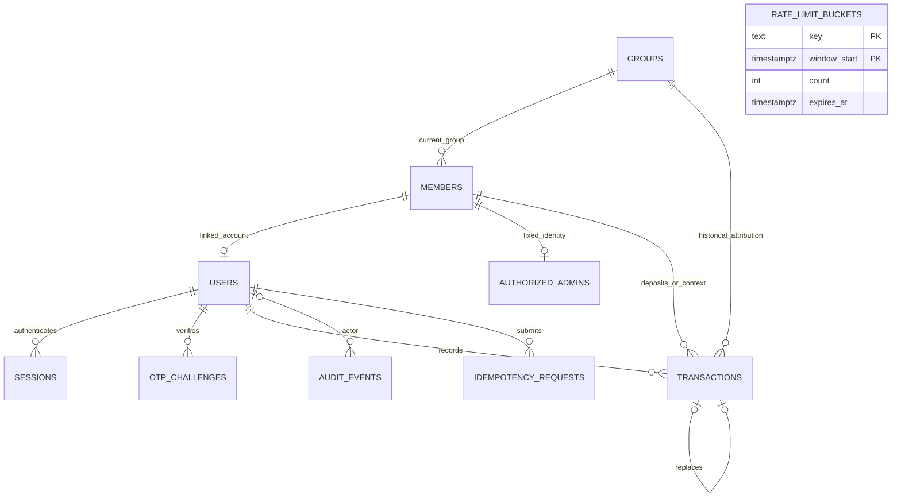

# 0001. Data and integrity contract

## Summary

Use a small relational model that separates roster identity, login accounts and financial records. Preserve historical group attribution on each transaction. PostgreSQL constraints back up service validation.

## Requirements

Scope AC-01, AC-05, AC-08 through AC-12; architecture AR-03 through AR-06. No account, deposit or expense can fabricate membership or an administrator role.

## Decision

Use the ten tables below. All identifiers are UUID primary keys unless a different key is stated. `?` means nullable; all other listed fields are NOT NULL. All timestamps are `timestamptz`. Foreign keys use ON DELETE RESTRICT. No hard delete API exists. (basis: approved scope, relational integrity and minimal application state)

## ERD

The diagram shows relationships; this dictionary defines the complete fields and constraints.

| Entity | Fields |
|---|---|
| `groups` | `id`, `code varchar(16) UNIQUE`, `name varchar(180)`, `version int DEFAULT 1`, `created_at` |
| `members` | `id`, `roster_key varchar(64) UNIQUE`, `name varchar(140)`, `group_id FK groups`, `version int DEFAULT 1`, `created_at`, `updated_at` |
| `authorized_admins` | `slot smallint PK CHECK 1..3`, `member_id FK members UNIQUE`, `email_normalized varchar(254) UNIQUE`, `created_at` |
| `users` | `id`, `email_normalized varchar(254) UNIQUE`, `name varchar(140)`, `password_hash text`, `member_id FK members UNIQUE ?`, `email_verified_at ?`, `status varchar(16)`, `status_before_suspension varchar(16) ?`, `reviewed_by FK users ?`, `reviewed_at ?`, `review_reason varchar(500) ?`, `version int DEFAULT 1`, `created_at`, `updated_at` |
| `sessions` | `id`, `user_id FK users`, `kind varchar(16)`, `created_at`, `expires_at`, `revoked_at ?`, `admin_otp_at ?` |
| `otp_challenges` | `id`, `user_id FK users ?`, `purpose varchar(24)`, `flow_secret_hash bytea`, `code_hmac bytea ?`, `generation int`, `attempts smallint`, `created_at`, `expires_at`, `last_sent_at`, `consumed_at ?`, `revoked_at ?`, `delivery_state varchar(16)` |
| `rate_limit_buckets` | `key text`, `window_start`, `count int`, `expires_at`; composite PK `(key,window_start)` |
| `transactions` | `id`, `kind varchar(8)`, `amount numeric(14,2)`, `business_date date`, `member_id FK members ?`, `group_id FK groups ?`, `expense_category varchar(16) ?`, `title varchar(160) ?`, `description varchar(1000)`, `member_name_snapshot varchar(140) ?`, `group_code_snapshot varchar(16) ?`, `group_name_snapshot varchar(180) ?`, `recorded_by FK users`, `recorded_by_name_snapshot varchar(140)`, `created_at`, `status varchar(8)`, `voided_by FK users ?`, `voided_at ?`, `void_reason varchar(500) ?`, `replaces_id FK transactions UNIQUE ?` |
| `audit_events` | `id`, `actor_user_id FK users ?`, `actor_kind varchar(12)`, `actor_label varchar(140)`, `operation varchar(64)`, `entity_type varchar(32)`, `entity_id uuid ?`, `occurred_at`, `request_id uuid`, `before_values jsonb ?`, `after_values jsonb ?`, `reason varchar(500) ?` |
| `idempotency_requests` | `id`, `actor_user_id FK users`, `operation varchar(64)`, `key uuid`, `request_hash bytea`, `response_status smallint`, `response_body jsonb`, `created_at`; UNIQUE `(actor_user_id,operation,key)` |

### Constraints and ownership

1. `groups` has exactly 10 validated rows and `members` exactly 26 after provisioning. Runtime database permissions prohibit insert/delete on these tables and all writes to `authorized_admins`; only the operator import role can provision them. Slot range plus unique primary key permits at most three authorized admins; provisioning and readiness require all three. Cross row counts are checked by the locked CLI transaction and readiness, not an invalid SQL CHECK subquery.
2. User states: `unverified`, `pending`, `approved`, `rejected`, `suspended`. Pending/rejected require verified email. Approved requires a member link. Suspension requires a valid previous state. Admin bootstrap is the sole path to approved with verification pending; no session is issued until OTP verifies email.
3. There is no editable `role` column. Role is `admin` only when the approved user's member ID AND normalized email match one `authorized_admins` row. Otherwise an approved user is a member. Public registration rejects use of reserved admin emails with the same generic response shape; approval cannot link a reserved admin member. No user API writes the authorization table.
4. A nullable unique member link allows multiple unlinked applicants but at most one account per member. The CLI verifies the three reserved members are linked only to their authorized emails. Changing a linked email/member is not exposed until its business policy is resolved.
5. Sessions have `kind` of `full` or `status`. Full requires approved, verified, linked identity on every request; admin full sessions also require `admin_otp_at`. Status sessions can only access own status/account metadata and logout, never roster/finance.
6. OTP purposes are `registration`, `admin_login`, `recovery`. Attempts are between 0 and 5. Delivery state is `pending`, `sent`, `failed` or `dummy`. A nullable user allows a synthetic recovery/duplicate registration flow with no revealing response. A partial unique index `(user_id,purpose) WHERE consumed_at IS NULL AND revoked_at IS NULL AND user_id IS NOT NULL` allows one current challenge. Expired rows are revoked before a new row is inserted. Resends retain attempts and change generation/code/expiry; they do not restore a five attempt allowance. Rate limits also cap new challenges.
7. Transaction amount is finite, positive and at most `999999999999.99`, the storage ceiling rather than an approved business cap. Explicitly reject PostgreSQL numeric NaN/infinity and input precision beyond two decimal places before persistence. `status` is `active` or `voided`; `kind` is `deposit` or `expense`.
8. Deposit: member and historical group and their snapshots required; expense category/title must be null. Expense: title required; category is `group` or `collective`; group and snapshots required only for group category, null for collective. Optional member and member snapshot are both present or both null. Description has trimmed length 1..1000; title 1..160.
9. Active records have null void metadata. Voided records require actor, timestamp and reason length 5..500. `replaces_id != id`. A replacement refers to a voided record of the same kind and at most one replacement exists per original. Service locks and the common mutation guard enforce cross row rules; unique/FK constraints enforce the rest.
10. Historical transaction fields cannot be edited. A database trigger rejects updates except a single active to voided transition and rejects deletes. Application SQL privileges omit DELETE. A correction creates a new row; it does not modify original amounts or attribution.
11. Audit actor kinds are `user` and `operator`; user events require an actor FK, operator events require a nonempty operator label. Do not copy secrets, credentials, challenge material or whole request bodies into before/after JSON. Runtime role has SELECT/INSERT only for audits and no UPDATE/DELETE; migration owner is separate.
12. Idempotency payloads contain only permitted financial/admin response projections. Keep financial idempotency receipts with the related history, so a late retry cannot create a second transaction. Retention of expired security state is separate from immutable financial history.

### Indexes

Keep PK/UNIQUE indexes above plus: `members(group_id)`, `users(status,created_at,id)`, `sessions(user_id,revoked_at)`, `sessions(expires_at)`, `otp_challenges(expires_at)`, `rate_limit_buckets(expires_at)`, `transactions(business_date DESC,created_at DESC,id DESC)`, partial active indexes on `transactions(member_id,business_date)` for deposits and `transactions(group_id,business_date)` for attributed records, `transactions(recorded_by)`, `audit_events(occurred_at DESC,id DESC)`, `audit_events(entity_type,entity_id,occurred_at)`. Add indexes only after measured query need beyond this set.

### Value sourcing

| Value | Authoritative source |
|---|---|
| IDs and timestamps | Backend UUID generator and database UTC clock |
| Roster names, keys and group codes | Validated private import, then audited allowed edits |
| Admin identity | Fixed authorization slot matched to linked user; never legacy leadership flags |
| Business date, amount, description, expense title/category | Validated request values |
| Deposit historical group | Selected member's current group read under the mutation guard at recording time; backdated policy gate remains unresolved |
| Expense historical group | Validated selected group for group expense, otherwise null |
| Name/code snapshots and recorded actor | Current locked source records at creation; not client supplied |
| Status, void actor/time and replacement linkage | Finance correction service |
| Totals | SUM over active transaction records, with Decimal and separate deposit/expense projections |

## Build plan

T03, T04, T10, T14 and T18 in the delivery contract implement this target in migrations sized to the first slice and later extensions. No legacy expense share table is migrated.

## Consequences and rationale

No cached balance table means aggregation is simple and cannot drift from the ledger. Snapshot columns cost small duplication but preserve meaningful historical attribution. Fixed provisioning means roster expansion needs a deliberate future change. (basis: approved accounting rules and relational integrity)
