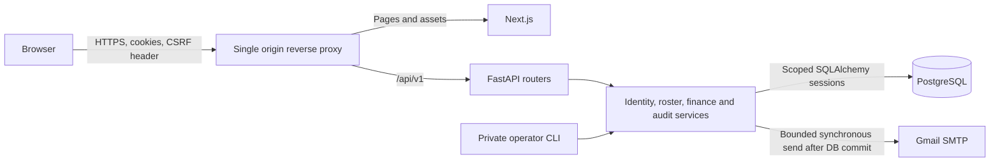

# 0001. Collective Finance Portal architecture

**Date:** 2026-11-24
**Status:** Proposed
**Technical design approval:** Accepted by you on 24 November 2026 after your own review. No independent AI critique was requested. This feature linked spec remains Proposed until development begins; Accepted lifecycle status is reserved for built and verified work. Implementation is not yet authorized.

## Summary

Build one modular application with a Next.js interface, a FastAPI backend and PostgreSQL. The backend owns authentication, permissions and accounting. The first working slice proves administrator OTP login, member approval, deposit recording and the member's real balance view before adding more features.

This is a consolidated architecture umbrella, with focused child contracts rather than separate planning rounds for every page. It is not implementation approval. The approved requirements remain in `docs/scope/scope.md`.

## Structure

| Document | Decision owned |
|---|---|
| [0001-data.md](0001-data.md) | Relational model, keys, constraints, indexes and immutable history |
| [0001-identity.md](0001-identity.md) | Identity, OTP, cookies, CSRF, revocation and permission enforcement |
| [0001-finance.md](0001-finance.md) | Exact accounting, atomic writes, historical attribution and idempotency |
| [0001-interface.md](0001-interface.md) | API contract, frontend routes, components and integration |
| [0001-delivery.md](0001-delivery.md) | Configuration, imports, deployment options and atomic build tasks |
| [verify.md](verify.md) | GA verification and acceptance evidence |
| [rationale.md](rationale.md) | Alternatives, tradeoffs and named sources |

Children share this lifecycle status. Their technical decisions are ratified; business decisions marked unresolved remain unapproved.

## Requirements

All scope FR-01 through FR-18, BR-01 through BR-14, NFR-01 through NFR-11 and AC-01 through AC-14 remain binding. FR-19/AC-15 are P1 and FR-20 is deferred P2. The child contracts refine rather than replace those criteria.

Additional architecture acceptance criteria:

| ID | Observable result |
|---|---|
| AR-01 | One browser origin serves the frontend and `/api/v1`; only FastAPI accesses PostgreSQL and SMTP. |
| AR-02 | The first real slice completes admin password/OTP, approval, deposit plus audit commit, and an approved member's updated ledger and collective balance. |
| AR-03 | Restarting or using another worker cannot reset OTP attempts, rate limits, revocations or duplicate submission protection. |
| AR-04 | Concurrent writes, approval conflicts, suspension races and failed audit inserts cannot create partial or unauthorized financial effects. |
| AR-05 | Every public/private response follows the field projections below; money crosses JSON as strings and private data is never statically published. |
| AR-06 | A clean test database migrates and accepts a validated synthetic roster of 26 people and 10 groups; exactly three administrator slots can be provisioned. |
| AR-07 | Configuration, recovery rehearsal and required GA checks pass before a release with real records. |

## Decision

Use a minimal modular monolith: one backend deployable, one frontend deployable and one database, released together. Domain separation is code organization, not separate network services. Preserve Tracer Bullet delivery and GA verification. (basis: approved scope and your architecture preferences)

Your confirmed deadline is **26 November 2026 at 00:00 Asia/Karachi**, equivalent to **25 November 2026 at 19:00 UTC**. P1/P2 do not enter the release path. The deadline does not authorize bypassing security or accounting tests, and this specification is not a feasibility guarantee.

## Proposed stack

| Layer | Choice | Reason |
|---|---|---|
| Interface | Next.js App Router, TypeScript, Tailwind CSS, shadcn/ui | Confirmed stack, retain the existing finance appearance |
| Backend | FastAPI with synchronous routers and SQLAlchemy 2 style sessions through Psycopg 3 | Straightforward transaction ownership with blocking database/SMTP work in synchronous handlers |
| Validation | Pydantic, unknown write fields forbidden | Explicit request/response contracts and prevention of mass assignment |
| Persistence | PostgreSQL, Alembic, NUMERIC(14,2), Python Decimal | Exact money and enforced relational constraints |
| Authentication primitives | PyJWT and pwdlib with Argon2id; Python secrets, hmac and hashlib | Established signing/hash primitives, no handwritten cryptography |
| Session state | Signed JWT cookie plus PostgreSQL session row, no refresh token for MVP | Simple revocation and bounded session lifetime |
| Email | Python SMTP client using Gmail submission with mandatory TLS | Small volume, no queue infrastructure; sender availability is a launch dependency |
| Testing | Pytest against real PostgreSQL, Playwright against the complete app | Tests the actual database constraints and browser cookie behavior |
| Delivery | One origin reverse proxy; frontend, API and PostgreSQL on a small host or managed equivalents | Avoid cross site cookie complexity and extra services |
| Observability | Structured redacted logs and readiness checks | Sufficient initial diagnosis without selecting another service |

Library patch versions will be pinned and checked during implementation, not guessed in this specification. No dependency is installed now. No cache, message broker, file storage service, websocket server or background job service is required.

## System architecture



The public edge terminates TLS, normalizes the trusted client address and routes requests. The API and database are not directly exposed publicly. Next.js never signs JWTs or writes database records. API authorization is authoritative even if a page guard is bypassed.

Use scoped database sessions, never shared between concurrent requests. The permission dependency uses a short read session and closes it before returning principal IDs. A mutation service opens a fresh session, owns `session.begin()`, acquires its guard and reloads authority inside that transaction. This avoids reusing SQLAlchemy's already started read transaction or stale identity objects. Read services use their own short session. Routers map errors; helpers may flush but never secretly commit. Close/rollback on every failure. No repository abstraction or event bus is needed. SMTP happens outside database transactions with explicit challenge delivery state.

## Minimal directory structure

```text
frontend/
  src/app/(auth)/             login, register, verify, pending, recovery
  src/app/(portal)/           overview, members, groups, ledger, account, admin
  src/components/ui/          shadcn/ui primitives
  src/components/finance/     cards, tables, forms, filters, navigation
  src/lib/                   api.ts, contracts.ts, money.ts
  tests/e2e/
backend/
  app/main.py
  app/core/                  config.py, security.py, dependencies.py, errors.py
  app/db/                    session.py, base.py
  app/routers/               auth.py, members.py, groups.py, finance.py, admin.py
  app/services/              identity.py, otp.py, mail.py, roster.py, finance.py, audit.py
  app/models/                identity.py, roster.py, finance.py, audit.py
  app/schemas/               auth.py, roster.py, finance.py, admin.py
  app/cli.py
  migrations/
  tests/                     unit/, integration/
infra/                       local composition and reverse proxy configuration
docs/scope/                  approved requirements
docs/specs/                  these contracts
```

These are proposed paths only. No directories outside documentation have been created. Keep the supplied legacy directory and ZIP untouched and outside public deployment roots. Do not turn the directories into independent services or introduce a shared package build system.

## Cross child contracts

1. UUIDs are generated by the backend; timestamps are timezone aware UTC; business dates are `date` values interpreted in Asia/Karachi. Currency is always PKR.
2. Amounts are canonical decimal strings with two fractional digits in responses. Financial calculations occur only in the API/database. JavaScript formatting must not determine balances.
3. Ten groups and 26 members are imported privately. Exactly three fixed authorization slots identify administrators. Leadership names/flags from the legacy application are not administrator credentials.
4. Each protected request reloads session and user eligibility from PostgreSQL. Admin permissions are derived from the fixed authorization table, never a request role or JWT role claim.
5. Sensitive writes, including session revocation, use the common short database mutation guard defined in the finance contract. This is deliberately coarse for 26 people.
6. No endpoint deletes financial history or grants admin roles. Corrections are void and optional replacement with a mandatory reason.
7. Unresolved business policies cannot be silently defaulted. Affected operations remain unbuilt or return `POLICY_UNRESOLVED` until the decision is ratified. This is an implementation guard, not permission to release an incomplete P0 feature.

## Build plan

The atomic feature execution plan is in `0001-delivery.md`, tasks T01 through T26. It starts with foundation and the real deposit path, then expenses, correction/history, account management and release verification. Child feature tasks own implementation; this umbrella does not duplicate their task lists.

## Consequences

Database state on every protected request is intentional: modest additional queries buy immediate revocation and clearer permissions. Serializing sensitive writes limits throughput but makes races tractable at this scale. Synchronous SMTP adds login latency and can fail independently of account creation, so delivery states and retries are explicit. No rolling token refresh means a user logs in again after the bounded session expires.

## Follow-up

Business blockers: overdraft policy, permitted financial dates and any lower amount cap, historical correction attribution, rejected account reapplication, member relinking/email changes, and administrator suspension/last usable admin policy. Deployment blockers: verified identities/roster, sender readiness, hosting/domain/operator, existing history inventory, backup/recovery targets and privacy retention obligations. See delivery decision register for exact gates.

You will name any additional tools. No skill discovery or installation is authorized. You approved the data model and technical specification. Explicitly unresolved business policies and deployment blockers remain open; no feature is claimed implemented or shipped.

## Rationale

Reasoning, alternatives and named sources: see [rationale.md](rationale.md).
